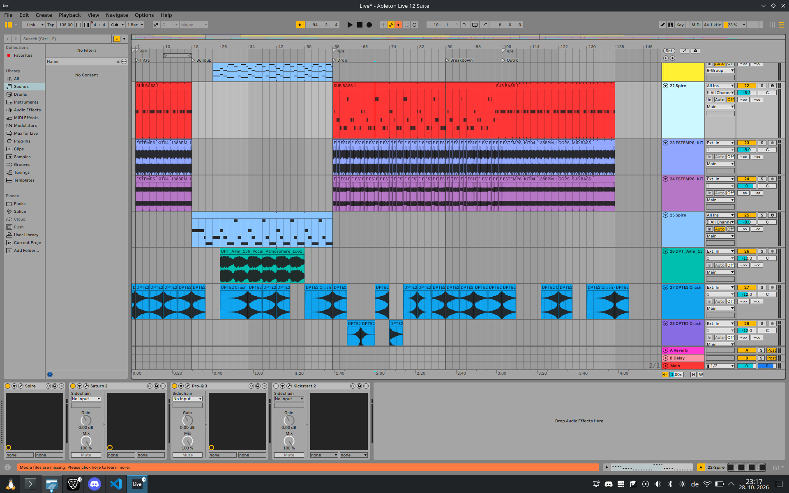

# Ableton Live 12 on Linux


<br>

This project brings you the Linux build of Ableton Live 12 that ships inside the Push 3 recovery image as a normal desktop app. With some custom shims it transforms it into a fully functional Live 12, but running natively on Linux. The content the image lacks (Core Library, lessons, stem models, cursors, icon) comes from the Windows Suite installer.

Ableton's files are not modified, and this repository contains none of them. A small launcher starts Live with a shim library preloaded. The shim makes Live work on the desktop: window, menus, file dialogs, plug-in editors, audio through PipeWire, and mixed-scale monitors.

This project is not affiliated with or endorsed by Ableton. Licensing is not touched: Live starts unauthorized, and you authorize it with your own Ableton account as usual.

<br>

## Requirements

### IMPORTANT: Due to this binary being compiled specifically for Push 3, which runs 11th Gen Intel CPU, it is restricted to AVX-512 instructions. Said instructions currently run only on <u>AMD Ryzen 7000 series</u> and above, and <u>Intel Core 10th and 11th Gen</u>.

<br>

Other requirements:
- An x86-64 PC with PipeWire, and glibc 2.35 or newer (Ubuntu 22.04, Mint 21, Debian 12, Fedora 36 or newer).
- An X11 session or Xwayland. Every mainstream desktop has one; Live runs as an X11 program.
- About 25 GB of free space while installing, and about 7 GB after (4.5 GB program, 2.1 GB Core Library).

<br>

### Install the tools the installer needs with one command:

| Distribution | Command |
|---|---|
| Arch, Manjaro, EndeavourOS, CachyOS | `sudo pacman -S --needed unzip e2fsprogs pipewire-alsa` |
| Debian 12+, Ubuntu 22.04+, Mint 21+ | `sudo apt install unzip e2fsprogs pipewire-alsa` |
| Fedora | `sudo dnf install unzip e2fsprogs pipewire-alsa` |
| openSUSE | `sudo zypper install unzip e2fsprogs pipewire-alsa` |

You do not need to install `innoextract`. The installer brings its own (see [innoextract](#innoextract)).

<br>

## Install
1. Create a new folder.
2. Clone this repository into a folder.

   ```sh
   git clone https://github.com/velkajelka/ableton-linux.git
   cd ableton-linux
   ```

   Or without git:

   ```sh
   curl -L -o ableton-linux.zip https://github.com/velkajelka/ableton-linux/archive/refs/heads/main.zip
   unzip ableton-linux.zip
   cd ableton-linux-main
   ```
3. You need your own copies of:

   - the Push 3 recovery image 2.4.7, available [here](https://cdn-downloads.ableton.com/hardware_updates/push3/2.4.7/Push3-RecoveryImage-2.4.7.zip)
   - the Windows installer of Live 12.4.7 Suite, available [here](https://cdn-downloads.ableton.com/channels/12.4.7/ableton_live_suite_12.4.7_64.zip)

   You can also access them on https://www.ableton.com/en/download/archive/ (but you need an account to download it from there).
4. Put both zips into the same folder, next to `install.sh`.
5. Run `install.sh`. Double-click it (it opens a terminal window that shows the progress and stays open at the end), or run it in a terminal:

   ```sh
   ./install.sh
   ```

GNOME Files opens scripts in the text editor by default. There, right-click `install.sh` and choose "Run as a Program", or use the terminal.

The program goes to `~/.local/share/ableton-live-12`. Use `--prefix DIR` for another folder; the path must not contain spaces or quotes. The installer adds Ableton Live 12 to the application menu. `.als` and `.alp` files and `ableton://` links (used for browser authorization) open in it.

The installation takes about 3 to 6 minutes and shows each of its 13 steps with a progress bar. You can delete the zips afterwards.

### Program loader

Live asks for the program loader at `/lib/ld-linux-x86-64.so.2`. Arch has it. Debian, Ubuntu, Mint and Fedora have it only at `/lib64/ld-linux-x86-64.so.2`.

When the link is missing, the installer asks `Create it now with sudo? [Y/n]`. Press Enter and type your password. This link is the only change outside your home folder. If you skip it, the installation still finishes, but Live does not start until you create the link:

```sh
sudo ln -s /lib64/ld-linux-x86-64.so.2 /lib/ld-linux-x86-64.so.2
```

### If the installation stops

Run `install.sh` again. It continues after the last finished step ("done by an earlier run") and needs less free space for the rest.

- The tools' messages are in `install.log` in the install folder. When a step fails, the installer shows its lines.
- A zip that is still being copied or downloaded, or is damaged, is reported as "not a complete zip".
- If the disk is full, the installer says so.
- Run on a complete installation, the installer asks "Install it again?". Your settings, licence and libraries stay. It refuses while Live is running.

<br>

## Uninstall

```sh
~/.local/share/ableton-live-12/uninstall.sh
```

It removes the program, the Core Library and the menu entry. Your User Library, recordings and projects in `<Music>/Ableton` always stay.

It asks whether to delete Live's settings and licence too (default: keep them). `--purge` deletes them without asking. It also asks whether to remove the loader link, if the installer made it. It refuses while Live is running.

<br>

## Not available in this build

While this appears like a fully functional build, it does not include some of the features the Windows build has, such as:

REX loops, VST2 (VST3 works), EXS24/SoundFont/Kontakt import, web views, video export, Push 2 display, Pack downloads, screen-reader support, and media keys.

<br>

## Where Live keeps its files

Live behaves like any Linux program and uses your home folder, the same places it uses on Windows and macOS:

| What | Where |
|---|---|
| Settings, log | `~/.config/Ableton/Live 12.4.7/` |
| Licence, file database | `~/.local/share/Ableton/` |
| Core Library, User Library, recordings, Factory Packs | `<Music>/Ableton/` (your desktop's Music folder, for example `~/Music` or a translated name) |

Live finds plug-ins in the usual folders (`~/.vst3`, `/usr/lib/vst3`, `/usr/local/lib/vst3`). Plug-ins keep their own settings and licences, shared with other programs. Windows plug-ins work through yabridge.

<br>

## Troubleshooting

| Problem | Cause and fix |
|---|---|
| Live does not start; a dialog names `/lib/ld-linux-x86-64.so.2` | The loader link is missing. Create it: `sudo ln -s /lib64/ld-linux-x86-64.so.2 /lib/ld-linux-x86-64.so.2` |
| "The audio engine is off" | Without `pipewire-alsa`, Live cannot share the sound card with the desktop. Install `pipewire-alsa` (see [Requirements](#requirements)), then restart Live. |
| The installer refuses the install folder | The path has a space or a quote. Live registers itself at every start through a command that does not quote its folder, so such a path gives an error dialog at each start. Choose another `--prefix`. |
| `innoextract` errors such as "Unexpected setup data version: 6.4.0.1" | Your system's innoextract is 1.9 or older. The installer uses its bundled copy first; check `install.log` for its messages. |
| `xdg-mime: ... qtpaths: command not found` in the terminal (Fedora) | Harmless. |
| Saving and exporting are deactivated | Live is not authorized yet. Authorize it with your Ableton account. |

<br>

## Contents

| Path | What it is |
|---|---|
| `install.sh` | The installer |
| `shim/` | `libmenufix.so` (prebuilt) and its sources |
| `tools/AbletonLive12-launcher` | The launcher, prebuilt from `tools/launcher.c` (static) |
| `tools/import-windows-content.sh` | Copies the Core Library, lessons, high-quality stem models and `Installation.cfg` (the edition: Suite) from the Suite installer |
| `tools/make-assets` | Makes Live's cursors and icon from the Suite's files; prebuilt from `tools/make-assets.cpp`, runs on Live's bundled Qt |
| `tools/kwin-plugin-rule.sh` | KDE: no minimize button on plug-in windows (the shim runs it) |
| `tools/bundled/innoextract` | innoextract 1.10-dev, which reads Live 12.4.7's installer |
| `tools/bundled/libxkbcommon*.so.0` | xkbcommon 1.5.0 from Debian 12, used only when the system has none |
| `tools/innoextract-compat.cpp` | Lets the bundled innoextract run on glibc 2.35 |
| `Options-desktop.txt` | Live options: ALSA MIDI, no start-up messages, no auto-updates |

<br>

## innoextract

Live 12.4.7's Suite installer is made with Inno Setup 6.4. innoextract 1.9, the latest release and the version most distributions ship, cannot read it ("Unexpected setup data version: 6.4.0.1"). Support for 6.4 exists only in innoextract's development code.

`tools/bundled/innoextract` is built from innoextract commit `6e9e34e`. Boost and libstdc++ are linked statically, and it needs glibc 2.35 or newer. If the bundled copy fails, the installer tries the system's innoextract. Fedora and openSUSE name the bzip2 library `libbz2.so.1`; the installer links it under the name innoextract expects, inside its work folder only.

## Third-party licences

- innoextract: zlib licence, see `tools/bundled/LICENSE.innoextract`.
- xkbcommon: MIT licence.
